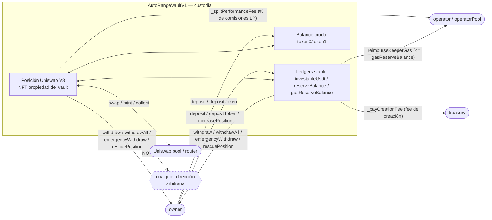
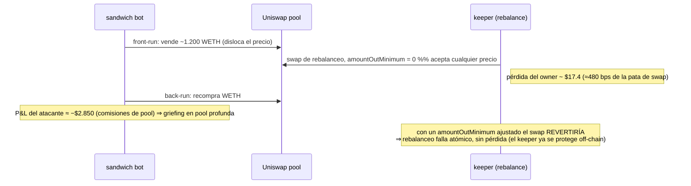
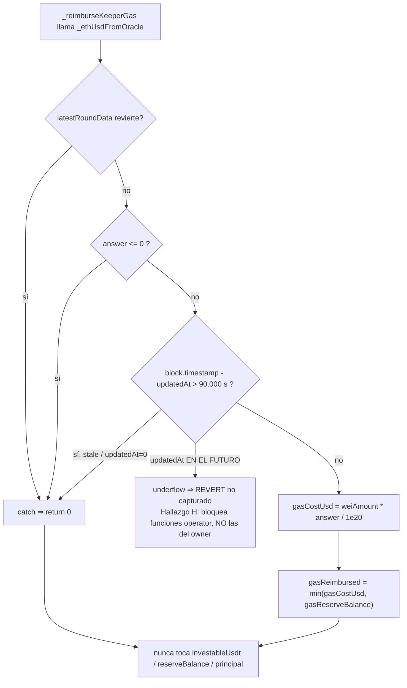

# Auditoría de caja blanca — contrato oficial AutoRange V1

**Fecha:** 2026-09-07/08
**Alcance (versión pública — solo on-chain; las secciones internas sobre el keeper y el frontend se omitieron):**
- `contracts/src/official/AutoRangeVaultV1.sol` (impl. mainnet `0xB2294bcC9841Ec8E412ef15e2243dBF37c3099BA`)
- `contracts/src/official/AutoRangeVaultFactoryV1.sol` (mainnet `0x288B7d7cD81620977062aa6eEdA2a64D93386502`)
- `contracts/src/official/AutoRangePlatformConfigV1.sol` (mainnet `0xa618111f9627cDc00B0F2329509B0E1EBfAda0c5`)
- Interfaces directas: `IPlatformConfig`, `INonfungiblePositionManager`, `ISwapRouter02`, `IAggregatorV3`, `IUniswapV3Factory`

**Metodología:** `contracts/audit/AUDIT_PROMPT_V5.md` (13 categorías), función por función contra el código real, más `slither` 0.11.4 (repo completo, severidad media+, sin informativos/naming) y **131 tests de Foundry** (+ verificación simbólica con halmos: 1/5 `check_` probado formalmente, 4/5 timeout por división /10000 en z3, ajeno al contrato) (6 archivos: unit de `AutoRangePlatformConfigV1`, fork Arbitrum, y fork Ethereum mainnet para la orientación `stableIsToken0 == true`).

**Contexto:** `AutoRangeVaultV1` es un *fork mecánico* de `RangeVaultArbCompoundV9` (idéntico a nivel de lógica y de firmas ABI — sólo se renombraron identificadores y se reescribieron docstrings). V9 ya pasó auto-auditoría de caja blanca + slither antes de su deploy. Esta auditoría (a) reconfirma que el fork no introdujo nada, y (b) re-superficie los gaps heredados que siguen vivos en el contrato inmutable que hoy es el oficial del protocolo.

---

## Resultado

**Cero hallazgos críticos / altos / medios.** `slither` no arrojó ningún hallazgo real nuevo (las 113 alertas caen todas en las 2 categorías ya aceptadas desde V1: destructuring parcial de tuplas, y "reentrancy" benigna sobre funciones que ya son `nonReentrant`). La invariante de ledgers que rompió V2 (`uncountedInvestable <= investableUsdt`) está clampeada en **todas** las reasignaciones medidas (verificado sitio por sitio). Las salidas de emergencia (`emergencyWithdrawPosition`, `rescuePosition`, `withdraw`/`withdrawAll` con swaps inertes) son genuinamente independientes de swaps y nunca están gateadas por `paused`/`closed`.

| # | Severidad | Título | Estado |
|---|-----------|--------|--------|
| A | Baja (aceptada) | `maxSlippageBps` declarado pero nunca aplicado on-chain — ampliado por el pool `isOperator` de V9 | Heredado, decisión explícita. Revisar en V-next con piso TWAP. |
| B | Baja | Valuación spot (`pool.slot0()`) de la pata volátil ⇒ eventos `Deposited`/`PositionIncreased` inflables ⇒ gaming de elegibilidad de referidos / B1 off-chain | Heredado. Mitigado en pools profundos; real en un par de baja liquidez. |
| C | Baja | `reinjectAmount -= reinjectFee` puede revertir por underflow en un vault financiado 100% vía la pata volátil de `depositToken()` (con `investableAmount == 0`) cuando un rebalanceo lleva `reinjectAmount < creationFeeFlatUsd` | **Vivo** (`creationFeeFlatUsd = $1` en mainnet). Sin fondos en riesgo. Workaround keeper-side. |
| D | Informativa | `setHardStop()` no valida el techo/piso contra el precio de mercado actual (sólo el orden techo-vs-piso) | Heredado. Guard agregado en el frontend 2026-09-06. |
| H | Baja | `_ethUsdFromOracle()` degrada bien ante todo modo NORMAL de fallo del feed (revert / stale / cero / negativo / ronda incompleta), pero un `updatedAt` en el **futuro** hace `block.timestamp - updatedAt` **underflow-revert dentro del branch de éxito del `try`** — el `catch` NO lo captura — y ese revert bloquea toda función operator que reembolsa gas (el rebalanceo automático se detiene). Las salidas del owner no dependen del oráculo, así que el owner nunca queda atrapado. | **Vivo** pero requiere un agregador Chainlink bizantino/comprometido (un feed real siempre reporta `updatedAt` pasado). Fix trivial para V-next. |
| I | Informativa | `_toStableUsd`/`_nativeWeiToStableRaw` (rama `volatileWei * sqrtPriceX96` dos veces) **desbordan 2²⁵⁶** si `pool.slot0()` devuelve un `sqrtPriceX96` cercano al máximo; ese cómputo alimenta `principalUsd` (sólo un dato de evento) y su overflow revierte `withdraw()`/`withdrawAll()`/`emergencyWithdrawPosition()` antes de `_payOwner`. | **No alcanzable en la práctica** — un pool canónico de Uniswap V3 no puede empujar su `sqrtPriceX96` cerca de ese régimen (la liquidez se agota mucho antes; el precio real está ~13 órdenes de magnitud abajo). `rescuePosition()` **no computa `principalUsd`** ⇒ es la salida inmune y sigue disponible. Fix de robustez para V-next: `unchecked`/saturante. |
| E | Informativa | Margen de bytecode ajustado (259 bytes en build de repo completo) | Nota de mantenimiento. |
| F | Informativa | `configureTarget()` no valida `targetTickLower < targetTickUpper` ni cordura de bps | `onlyOwner`, autoinfligido, el mint revierte. |
| G | Informativa | `_reimburseKeeperGas()` / `_splitPerformanceFee()` pagan a `operator` (primario), no a `msg.sender` — una wallet de respaldo del pool que opera un vault paga gas pero no se reembolsa directamente | Interno a la infra del propio protocolo; "lavado" contable entre wallets propias. |
| J | Informativa | `rescuePosition()` deja el vault **medio-vivo** (`paused = true`, `closed = false`): el owner que quiso salir todavía tiene un contrato aceptando `deposit()`/`configureTarget()`, y ninguna de las 3 salidas totales (`rescuePosition`/`withdrawAll`/`emergencyWithdrawPosition`) barre y cierra el vault en la misma transacción. Un NFT de posición o un ERC-20 ajeno al par enviado a esa dirección después queda irrecuperable (no hay readopción de NFT ni barredor genérico). | Sin fondos en riesgo por la función en sí (los baldes de stable y los tokens del par siguen retirables vía `withdrawAll()` incluso tras un rescate o un `closeVault()`). Recomendación V-next: modo `sweepAndClose` opt-in. |

---

## Hallazgos

### A — `maxSlippageBps` declarado, nunca aplicado on-chain (Baja, aceptada; ampliada por V9)

**Dónde:** `setRiskParams()` guarda `maxSlippageBps`; `_executeSwap()` / `_doExactInputSingle()` / `_convertPayoutToStable()` / `_swapThirdPartyToStable()` confían 100% en el `amountOutMinimum` que envía quien llama (`swapIx.amountOutMinimum`), sin compararlo nunca contra `maxSlippageBps`. Todos los swaps van además con `sqrtPriceLimitX96: 0`, y `_decreaseAndCollect()` usa `amount0Min: 0, amount1Min: 0` hardcodeado.

**Quién puede explotarlo y bajo qué condición real:**
- El `operator` (wallet del keeper) — o, **nuevo en V9/oficial**, cualquier wallet del `operatorPool()` de la plataforma sembrada en `isOperator` al crear el vault — puede enviar un `amountOutMinimum` bajo en cualquier `rebalance()`/`initPosition()`/`operatorForceRebalance()`/`reinjectIntoPosition()`/`sweepIdleDust()`/`harvestFees()` sin ningún freno on-chain.
- Un bot de MEV que vea la tx del keeper podría sandwichearla si el `amountOutMinimum` deja margen (superficie menor en Arbitrum, no nula).
- Un bug futuro en el sizing off-chain de `rebalancer.ts` se traduce directo en pérdida real, sin verificación de respaldo.

**Por qué el alcance es acotado, no catastrófico:** es fuga de valor rebalanceo por rebalanceo, acotada por `maxRebalances` (para `rebalance`/`ownerRebalance`; `operatorForceRebalance` no lo respeta) y por que `withdraw()`/`withdrawAll()`/`emergencyWithdrawPosition()`/`rescuePosition()` **nunca** dependen de que el vault esté sin pausar — el owner siempre puede sacar su capital apenas note algo raro. `setPaused(true)` (owner) bloquea instantáneamente a **todos** los operadores (primario + pool).

**Medición (Prueba 2 — sandwich/MEV, `test_sandwich_measureSlippageLoss_amountOutMinimumZero`, fork real):** sobre la pool de producción USDC/WETH 0.05%, un vault de ~$945 cuya posición salió de rango y se rebalancea con una pata de swap de ~$362 y `amountOutMinimum = 0`, sandwicheado por un atacante que disloca el precio con ~1.200 WETH (~$3M) antes y lo revierte después:
- pérdida del owner en ese rebalanceo: **~$17.4** (≈ **480 bps de la pata de swap**, ≈ **184 bps de la posición**);
- P&L del atacante: **≈ −$2.850** — paga mucho más en comisiones de pool (0.05% × 2 patas sobre millones de volumen) de lo que extrae. En esta pool profunda es un ataque de **griefing** (el atacante pierde ~168× lo que le cuesta a la víctima), no uno económicamente racional. Una pool **fina** (un fee tier nuevo no-USDC/WETH) invierte esa relación.
- **El keeper ya se protege off-chain** (`test_sandwich_wellBehavedKeeperWithTightMinIsProtectedOffChain`): el mismo swap sandwicheado, dimensionado con un `amountOutMinimum` ajustado calculado del precio PRE-sandwich, **revierte** ("Too little received") ⇒ el rebalanceo falla atómico, la posición y los ledgers quedan intactos, el owner no pierde nada. El gap on-chain es solo que el contrato no lo **obliga**.

**Amplificación de V9 que hay que documentar explícitamente:** el `isOperator` mapping convierte el radio de daño de "una wallet comprometida afecta un vault" a "afecta todo vault V9/oficial que tenía esa wallet en su `operatorPool()` al momento de crearse" (sembrado una sola vez, nunca re-sincronizado — sacar una wallet del pool de plataforma NO la revoca retroactivamente). No hay revocación masiva; hay que llamar `setOperatorStatus(wallet, false)` vault por vault. Hoy `operatorPool()` está **vacío** en mainnet, así que el radio real es el mismo que antes de V9 hasta que se provisione una wallet de respaldo.

**Recomendación:** para la próxima versión, un `_enforceSlippage()` basado en un piso TWAP on-chain (no en `pool.slot0()` — ese piso ya se intentó y se revirtió en V5 porque el spot no anticipa el impacto real de precio y rompía rebalanceos legítimos). Mientras tanto: mantener el `operatorPool()` mínimo y sólo con wallets del propio protocolo, y monitorear cada rebalanceo real (ya se hace vía `keeper_rcrlp_shadow_calls`).

---

### B — Valuación spot de la pata volátil ⇒ eventos inflables ⇒ gaming de referidos / B1 (Baja)

**Dónde:**
- `depositToken()`, rama `tokenIn == _volatileAddr()`: `realValue = _nativeWeiToStableRaw(balanceOf(volatile) - volatileBefore)` — valor USD del volátil recibido **a precio spot `pool.slot0()`** (medido antes del swap, así que no se puede "lavar" capital ya contado, pero sí se puede inflar el precio). Luego `if (realValue < total) revert DeclaredExceedsRealBalance()` — es decir, un `realValue` inflado permite declarar un `total` (y por ende un `Deposited(investableAmount, reserveAmount, gasReserveAmount)`) mayor al valor real.
- `_finishIncreasePosition()`: `feeVolatile` y `volatileFoldedUsd` se valúan igual, vía `_nativeWeiToStableRaw()` / spot. `PositionIncreased.volatileFoldedUsd` queda acotado por `min(realVolatileTopUp, volátil realmente usado en el mint)` en *unidades*, pero su **valor USD** es spot.

**Quién y cómo:** `depositToken()`/`increasePosition*()` son `onlyOwner` — no hay robo a terceros. El vector real es contra el sistema off-chain: un owner (a) infla el precio spot de una pool de baja liquidez comprando volátil fuerte en el mismo bloque, (b) hace un `depositToken(volatile, montoChico, ..., investableAmount = inflado)` que pasa el chequeo `realValue < total`, (c) revierte la manipulación. El evento `Deposited` queda con el monto falso para siempre; `frontend/lib/referrals/eligibility.ts` (`checkReferrerEligible` / `sumIndexedEventUsd(..., "Deposited")`) suma exactamente ese campo sin re-verificar contra balance real ⇒ elegibilidad de referido fraudulenta (100% de comisión en vez del 50% reducido) sin arriesgar capital real. Lo mismo con `B1` (contabilidad off-chain que el keeper le pasa a uni-lab.xyz).

**Mitigaciones presentes:**
- `AutoRangeVaultFactoryV1.createVault()` verifica la pool contra la factory real de Uniswap (`getPool(token0, token1, fee) != pool → UnverifiedPool`), así que **debe** ser una pool genuina — no una `FakePool` con `slot0()` arbitrario. Pero una pool real y **fina** (fee tier nuevo, TVL bajo — WBTC/USDT0, LINK/USDT0, cualquier par curado a futuro) sigue siendo barata de mover un bloque.
- Sobre la pool profunda USDC/WETH 0.05% de Arbitrum, mover el spot lo suficiente es económicamente impracticable.
- `depositToken()` con la pata **stable** (`tokenIn == _stableAddr()`) y `deposit()` a secas usan deltas de balance real, no spot — no inflables.

**Recomendación:** acotar la valuación de la pata volátil (p. ej. clamp contra un TWAP corto), o —más simple a nivel producto— gatear la elegibilidad de referidos únicamente sobre depósitos en stable. Heredado desde V4/V5 y ya documentado en `CLAUDE.md` ("Riesgos de bajo alcance aceptados", categoría 13 del prompt de auditoría). Se re-superficie porque sigue vivo en el contrato oficial inmutable.

---

### C — Underflow en `reinjectAmount -= reinjectFee` (Baja; **vivo en mainnet**)

**Dónde:** `_rebalanceCore()`, bloque de reinyección de reserva:
```solidity
uint256 reinjectFee = _creationFeeFor(reinjectAmount);
_payCreationFee(reinjectFee);
reinjectAmount -= reinjectFee;   // <-- puede revertir por underflow (Solidity ^0.8)
```
`_creationFeeFor(baseAmount)` devuelve `flatUsd` completo cuando `cumulativeFeeableUsd == 0 && flatUsd > 0` (la comisión plana única, que se cobra "de una" en la primera llamada fee-elegible del vault). Si en ese momento `reinjectAmount < flatUsd`, la resta subdesborda y toda la tx revierte.

**Condición real para alcanzarlo:**
1. El vault se financió **enteramente** a través de la pata volátil de `depositToken()` con `investableAmount == 0` (y, opcionalmente, `deposit()` sólo a reserva/gas, también con `investableAmount == 0`). En ese caso `_creationFeeFor(0)` sale temprano y `cumulativeFeeableUsd` nunca avanza de 0.
2. `initPosition()` mintea desde el balance de volátil (posición unilateral válida en Uniswap).
3. `AutoRangePlatformConfigV1.creationFeeFlatUsd() > 0`. **En mainnet vale `$1` (`1_000_000`).**
4. Un `rebalance()` / `ownerRebalance()` / `operatorForceRebalance()` lleva `reinjectAmount ∈ [1, 999_999]` (menos de $1) y hay `reserveBalance` suficiente para pasar el `InsufficientReserve` previo.

**Impacto:** ninguno sobre fondos — la tx revierte atómica (`reserveBalance` se restaura). El único efecto es que ese rebalanceo puntual, con ese `reinjectAmount` sub-$1, no puede completarse; el keeper reintenta con `reinjectAmount = 0` (la reinyección de reserva es opcional) o con un monto ≥ `$1`. En cuanto cualquier capital fee-elegible fluya por `_creationFeeFor` (un `deposit`/`depositToken` con `investableAmount > 0`, un `increasePosition` con `usdtAmount > 0`, o un reinject ≥ `$1`), `cumulativeFeeableUsd` pasa a `> 0` y el problema desaparece para siempre.

**Recomendación:** en la próxima revisión de contrato, resta saturante (`reinjectAmount = reinjectAmount > reinjectFee ? reinjectAmount - reinjectFee : 0`) o saltar la reinyección si `reinjectFee >= reinjectAmount` — mismo criterio "resta saturante en caminos no críticos" que el resto del codebase ya usa. Mientras tanto (contrato inmutable): **el keeper nunca debe pasar `reinjectAmount` por debajo de `creationFeeFlatUsd`** cuando `cumulativeFeeableUsd` podría ser 0; o la plataforma deja `creationFeeFlatUsd = 0` (era el valor de arranque de instancias anteriores).

Regresión: `test/AutoRangeVaultV1Audit.t.sol::test_finding_reinjectFeeUnderflow_onVolatileOnlyFundedVault`.

---

### D — `setHardStop()` no valida el techo/piso contra el precio de mercado (Informativa)

`setHardStop(bool isCeiling, bool enabled, int24 tick, bool convertToStable)` sólo valida el **orden** techo-vs-piso (`_hardStopOrderValid()`, direction-aware — verificado correcto en ambas orientaciones de `stableIsToken0`). No valida que `tick` caiga del lado correcto del precio actual, ni que esté dentro del rango de tick de Uniswap (`±887272`). Un owner que configure un techo por debajo del mercado hace que el próximo `rebalance()` cierre la posición y pause el vault de inmediato. `onlyOwner`, autoinfligido, recuperable (`withdraw` funciona pausado). El frontend agregó un guard client-side el 2026-09-06 (ver `techo-precio.md`/`piso-precio.md`). Un `tick` fuera del rango de Uniswap con `enabled=true` simplemente nunca dispara (benigno). Sin acción de contrato.

---

### E — Margen de bytecode ajustado (Informativa)

`AutoRangeVaultV1` compila a **24,317 bytes** de runtime en el build del repo completo (`via_ir`, `optimizer_runs=1`, `bytecode_hash=none`) — **259 bytes** bajo el límite EIP-170. El contrato desplegado en mainnet se compiló en un build aislado (`bytecode_hash=ipfs`) a ~24,154 + ~53 bytes de metadata CBOR — también bajo el límite. Cualquier mantenimiento futuro sobre esta base debe re-verificar con `forge build --sizes` limpio. (Nota separada: `RangeVaultRobinhoodCompoundV8` reporta 24,777 bytes por caché stale de build — `forge clean` lo devuelve a 24,474; no afecta al contrato oficial.)

---

### F — `configureTarget()` sin validación de cordura (Informativa)

No valida `targetTickLower < targetTickUpper`, ni alineación a `tickSpacing`, ni topes de `recenterMarginBps`/`maxRangeDeviationBps`/`exitTop*`. `onlyOwner`; un rango invertido hace revertir el `mint` en `initPosition()`. Autoinfligido, sin fondos en riesgo.

---

### G — Reembolso de gas y performance fee van al `operator` primario, no a `msg.sender` (Informativa)

`_reimburseKeeperGas()` transfiere el reembolso a `operator` (el slot primario); `_splitPerformanceFee()` transfiere la comisión de plataforma a `operator`. Si una wallet de respaldo del `operatorPool()` (`isOperator[msg.sender] == true`, `msg.sender != operator`) opera un vault, paga el gas de la tx pero el reembolso en stable lo recibe la wallet primaria. Como ambas wallets pertenecen al mismo protocolo, es un "lavado" contable interno (hay que rebalancear stable entre wallets off-chain), no un beneficio para un tercero. Consistente entre ambas transferencias. Nota de diseño.

---

### H — `_ethUsdFromOracle()` revierte (no degrada) si el feed reporta `updatedAt` en el futuro (Baja; encontrado en Prueba 3)

**Dónde:** `_ethUsdFromOracle()`:
```solidity
try IAggregatorV3(gasPriceOracle).latestRoundData() returns (uint80, int256 answer, uint256, uint256 updatedAt, uint80) {
    if (answer <= 0) return 0;
    if (block.timestamp - updatedAt > MAX_GAS_ORACLE_STALENESS) return 0;   // <-- underflow si updatedAt > block.timestamp
    return (weiAmount * uint256(answer)) / 1e20;
} catch {
    return 0;
}
```
`block.timestamp - updatedAt` corre en el **branch de éxito del `try`** (contexto de este contrato, no de la llamada externa). Con `updatedAt > block.timestamp` subdesborda y revierte (Solidity ^0.8). El `catch` **sólo** captura reverts de la llamada externa `latestRoundData()`, no del cuerpo del branch de éxito — así que ese revert se propaga.

**Impacto:** `_ethUsdFromOracle()` se llama desde `_reimburseKeeperGas()` **sin** `try` — así que revierte por completo `initPosition()`, `rebalance()`, `operatorForceRebalance()`, `reinjectIntoPosition()`, `harvestFees()`, `sweepIdleDust()` (toda función operator que reembolsa gas). **El rebalanceo automático del vault se detiene** mientras el feed esté en ese estado. Las salidas del owner (`withdraw`/`withdrawAll`/`emergencyWithdrawPosition`/`rescuePosition`/`collectFees`) **no llaman al oráculo**, así que el owner nunca queda atrapado — puede sacar todo su capital. Verificado en `test_oracle_futureUpdatedAt_underflowRevertsAndBlocksOperatorActionsOnly` (los 3 caminos operator revierten `Panic(0x11)`, el `withdrawAll` del owner funciona).

**Probabilidad:** requiere un agregador Chainlink **bizantino o comprometido** — un feed real siempre escribe `updatedAt = block.timestamp` de la ronda, nunca un timestamp futuro. Es un gap de codificación defensiva, no un vector explotable por un tercero.

**Distinción con los modos que SÍ degradan bien** (todos verificados en Prueba 3): revert de la llamada → `catch` → 0; `updatedAt` viejo (stale) → `block.timestamp - updatedAt > 90_000` → 0; `updatedAt == 0` (ronda incompleta) → `block.timestamp - 0` es enorme → 0; `answer <= 0` (cero o negativo) → 0. Sólo el caso `updatedAt` **futuro** rompe.

**Recomendación (V-next):** `if (updatedAt > block.timestamp || block.timestamp - updatedAt > MAX_GAS_ORACLE_STALENESS) return 0;` — o restar de forma saturante. Una línea.

---

### I — Overflow en el cómputo B1 de `principalUsd` ⇒ DoS temporal de `withdraw`/`withdrawAll`/`emergencyWithdrawPosition` (Informativa; no alcanzable en la práctica)

**Dónde:** `_nativeWeiToStableRaw()`, rama `!stableIsToken0`:
```solidity
uint256 step1 = (volatileWei * sqrtPriceX96) >> 96;
return (step1 * sqrtPriceX96) >> 96;   // <-- step1 * sqrtPriceX96 puede pasar 2^256
```
`_nativeWeiToStableRaw` → `_toStableUsd` → `principalUsd` en `Withdrawn`/`EmergencyWithdraw` (y en `_sweepLedgersAndPrincipalUsd`). Ese `principalUsd` es **puramente un dato de evento** (contabilidad B1 off-chain) — pero su overflow revierte toda la función **antes de `_payOwner`**.

**Umbral (calculado):** el overflow requiere `sqrtPriceX96 > sqrt(2³⁵² / volatileWei)`. Para una pata volátil de ~0.2 WETH (2e17 wei), eso es `sqrtPriceX96 > ~2.1e44` — sólo ~4300× por debajo de `MAX_SQRT_RATIO` (1.46e48), lo que corresponde a un tick cercano a `MAX_TICK` (887272) y a un precio absurdo (WETH ≈ 10⁴² USDC).

**Por qué no es alcanzable:** un pool canónico de Uniswap V3 **no puede** empujar su `sqrtPriceX96` a ese régimen — un `swap` con `sqrtPriceLimitX96 = 0` se detiene cuando se agota la liquidez del último tick inicializado, muy por debajo de esos extremos. Y `createVault()` ya verifica que el pool sea el canónico (`UnverifiedPool`), así que `slot0()` es confiable. `test_finding_b1EventOverflow_realPriceIsFarFromTheThreshold` confirma que el `sqrtPriceX96` real del pool está ~13 órdenes de magnitud por debajo del régimen de overflow.

**Mitigación que ya existe:** `rescuePosition()` **no computa `principalUsd`** — sólo hace `positionManager.transferFrom(this, owner, tokenId)`. Es la salida de último recurso genuinamente inmune a este overflow (y también a la manipulación de spot y al oráculo). `test_finding_b1EventOverflow_dosesWithdrawPaths_rescueIsImmune` lo demuestra: con `slot0()` mockeado al extremo, las 3 rutas de `withdraw` revierten `Panic(0x11)` pero `rescuePosition()` funciona y el owner recupera el NFT.

**Recomendación (V-next):** envolver el cómputo de `principalUsd` en `unchecked` (o una conversión saturante) — mismo criterio que V3 aplicó a `investableUsdt - uncountedInvestable` en los caminos de emergencia. El evento quedaría con un `principalUsd` incorrecto en el caso extremo, pero la transferencia de fondos nunca se bloquearía.

---

### J — Ninguna salida total barre y cierra el vault en la misma transacción (Informativa; recomendación V-next)

**Dónde:** `rescuePosition()`, `withdrawAll()`, `emergencyWithdrawPosition()`.

**El síntoma:** las tres son "me quiero ir", pero ninguna deja el vault genuinamente muerto:

- `rescuePosition()` sólo hace `positionTokenId = 0; paused = true; transferFrom(NFT)`. **No** toca los 3 baldes de stable, **no** barre `token0`/`token1` crudos, **no** pone `closed = true`. El vault queda `paused` pero perfectamente capaz de recibir `deposit()`, `configureTarget()`, etc.
- `withdrawAll()` barre todo al owner y cierra la posición, pero **no** pone `closed = true` — el owner sigue teniendo que llamar `closeVault()` en una 2ª transacción.
- `emergencyWithdrawPosition()` barre todo y `paused = true`, pero tampoco `closed`.

**El riesgo irreducible:** el owner que ya se fue tiene un contrato "vivo" en una dirección conocida. Lo que le mande ahí después:

| Enviado a la dirección del vault post-salida | ¿Recuperable? |
|---|---|
| Los 3 baldes de stable (`investableUsdt`/`reserveBalance`/`gasReserveBalance`) | **Sí** — `withdraw()`/`withdrawAll()` no están gateados por `paused` ni por `closed`. |
| `token0`/`token1` del par, en crudo | **Sí** — el balde de polvo de `withdraw()` y el barrido de `withdrawAll()` leen `balanceOf` real. |
| El NFT de posición devuelto | **No** — no hay función de readopción. Atrapado. |
| Un ERC-20 que no sea del par | **No** — el contrato no tiene barredor genérico. Atrapado. |

Ningún cambio de contrato elimina del todo el caso "NFT / token ajeno enviado a mano a una dirección" — eso es cierto para cualquier contrato. Lo que sí se puede es cerrar la ventana de "vault medio-vivo que invita a fondearlo por error" y dejar una señal inequívoca de que está muerto.

**Recomendación (V-next):**

1. **`rescuePosition(bool sweepAndClose)`** — `false` conserva el comportamiento actual exacto (modo ultra-robusto: sólo el `transferFrom` crudo del NFT, que nunca debe depender de que un `safeTransfer` de ERC-20 funcione — USDC congelable, token pausado). `true` → tras sacar el NFT: `safeTransfer` de `balanceOf(token0)`/`balanceOf(token1)` al owner, los 4 ledgers a cero, `closed = true`. El `transferFrom` del NFT va **primero y solo**; si el barrido revirtiera, el owner cae al modo `false`.
2. **`withdrawAll(..., bool alsoClose)`** — un flag que hace `closed = true` en la misma transacción cuando el vault queda genuinamente vacío, ahorrando la 2ª tx de `closeVault()`.
3. **`emergencyWithdrawPosition()`** — igual criterio, pero la emergencia debe quedarse mínima: el `closed = true` iría **después** del `_payOwner` y sin ninguna rama nueva que pueda revertir. Opt-in o directamente no, según cuánto se valore mantener esa función con cero superficie añadida.
4. **Opcional y aparte:** un `sweepToken(address token) onlyOwner` para recuperar ERC-20 ajenos enviados por error — el proyecto evitó históricamente un barredor genérico (bytecode + superficie), es una decisión de costo. Es la única forma de cubrir el caso "token que no es del par".

**Mitigación aplicada en V1** (frontend, `VaultDetail.tsx`, 2026-09, sin cambio de contrato): los 3 caminos de salida total **fuerzan** la firma de `closeVault()` como paso final encadenado — `withdrawAll()` → `closeVault()` (2 firmas), `emergencyWithdrawPosition()` → `closeVault()` (2 firmas), `rescuePosition()` → `withdrawAll()` → `closeVault()` (3 firmas). No hay opción de "solo vaciar" desde la UI; un owner que quiera un vault nuevo lo crea en `/create`. La primera firma de cada camino (el retiro/rescate en sí) sigue siendo independiente y robusta: si una posterior revierte, los fondos ya están en la wallet del owner y los botones de la página permiten terminar la limpieza a mano. Un banner ámbar adicional detecta cualquier vault que haya quedado vacío-pero-abierto (p. ej. de antes de este cambio, o si el owner rechazó la firma de cierre) y ofrece `closeVault()` en un clic. El caso irreducible (NFT / token ajeno enviado a mano a la dirección) sigue sin cobertura posible — la guía en `/recursos/tutoriales` es "nunca envíes nada a la dirección del vault". La recomendación V-next de arriba (barrido + cierre atómico en el propio contrato) reduce esa secuencia de 2-3 firmas a 1.

---

## Modelo de amenaza — ¿alguien puede robar fondos?

**No.** Propiedad estructural: **ninguna función tiene un parámetro de destinatario.** Toda salida de tokens del vault va a una de tres direcciones fijas (`owner`, `operator`, `treasury`) o a la propia posición (`recipient: address(this)` en cada `mint`/`swap`/`collect`). Verificado con tests que graban cada `Transfer` emitido durante una acción del keeper y fallan ante cualquier `from == vault` hacia una dirección que no sea protocolo.

- **Externo (ni owner, ni operator, ni wallet del `operatorPool`):** cero entrypoints autenticados sobre un vault ajeno — las ~25 funciones que cambian estado revierten `NotOwner`/`NotOperator` (`test_external_everyStateChangingFunctionReverts`). No puede mover el NFT de la posición (no es owner ni approved, el vault nunca dio approval a nadie; `rescuePosition` es `onlyOwner`) — `test_external_cannotMoveThePositionNft`. No puede re-inicializar para robar `owner` (`test_external_cannotReinitializeToHijackOwnership`). `createVault()` es permissionless pero le da un vault **nuevo y vacío**, sin tocar el ajeno (`test_external_createVaultYieldsFreshEmptyVault_originalUntouched`). `onERC721Received` sólo lo puede llamar el `positionManager`. El único efecto indirecto es MEV/sándwich sobre un swap iniciado por el operador — fuga de valor por slippage hacia la pool, acotada por el `amountOutMinimum` que fija el keeper, nunca un drenaje.
- **Keeper (`operator` o wallet del pool comprometida):** no puede transferir principal a sí mismo ni a ninguna dirección (no hay parámetro `to`; `_payOwner` sólo va a `owner`). No puede llamar ninguna función `onlyOwner` — incluidas todas las salidas de retiro (`test_keeper_cannotCallAnyOwnerOnlyPath`). Su extracción real: (a) legítima — el performance fee (% de comisiones LP ganadas, lo fija la plataforma) + gas honesto; (b) abusiva — reembolso de gas ~3× (clamp `effectiveGasPrice = min(tx.gasprice, 3×basefee)` + feed Chainlink dedicado, **acotado a `gasReserveBalance`**, jamás al principal) + sangrado de slippage en swaps (Hallazgo A). En un rebalanceo lo más adversarial posible (`amountOutMinimum = 0`) el principal **sigue dentro del vault** y el owner recupera ≥97% con `withdrawAll`, mientras la ganancia del operador es <$1 de gas (`test_keeper_adversarialRebalance_principalStaysRecoverable_takeBoundedToGas`). El keeper tampoco puede varar el capital en un rango absurdo (`_checkRangeNearMarket`) ni rebalancear más allá del techo/piso absoluto (`_hardStopTriggered()` on-chain), y el owner puede `setPaused(true)` + retirar (nunca gateado por pausa) en cualquier momento.
- **Frontera de confianza (no es keeper ni externo):** el owner de `AutoRangePlatformConfigV1` (la plataforma) lee `performanceFeeBps` en vivo y puede subirlo a 100% ⇒ se quedaría con el 100% de las comisiones LP **futuras** de todo vault (nunca el principal). Inherente al diseño; único actor con palanca económica amplia sobre vaults ya creados.

## Diagramas de flujo

### Fund flow — a dónde pueden ir los tokens (respuesta al "¿se pueden robar fondos?")



Toda salida del vault va a `owner`, `operator`, `treasury` o la propia pool — **ninguna función acepta un `recipient`/`to` arbitrario**. Un externo no tiene entrypoints autenticados; el keeper sólo alcanza el % de comisiones (lo fija la plataforma) + gas (tope `gasReserveBalance`).

### Prueba 1 — atomicidad de `createVault()` (clone + initialize en 1 tx)

```mermaid
sequenceDiagram
    participant EOA as msg.sender
    participant F as AutoRangeVaultFactoryV1
    participant UF as UniswapV3Factory
    participant C as clon (nuevo)
    EOA->>F: createVault(pool, stable, volatile, fee)
    F->>pool: token0() / token1()   %% STATICCALL — una pool maliciosa no puede reentrar
    F->>UF: getPool(t0,t1,fee) == pool ? (si no: revert UnverifiedPool)
    F->>C: CREATE (Clones.clone)  %% recién aquí la dirección tiene código
    F->>C: initialize(owner=msg.sender, ...)  %% MISMA tx, sentencia siguiente
    F-->>EOA: vault
    Note over EOA,C: no hay ventana para que un tercero llame initialize() primero;<br/>re-init posterior revierte (OZ initializer)
```

### Prueba 2 — sandwich / MEV con `amountOutMinimum = 0`



### Prueba 3 — resiliencia del oráculo de gas (`_ethUsdFromOracle`)



### Prueba 5 — qué lee cada vault de `PlatformConfig` (en vivo vs. sembrado una vez)

```mermaid
flowchart LR
    subgraph PC[AutoRangePlatformConfigV1  (onlyOwner)]
      pfb[performanceFeeBps]
      cap[maxDepositUsd]
      tre[treasury]
      cfp[creationFeeParams]
      frc[forceRebalanceCooldownSeconds]
      dop[defaultOperator]
      opp[operatorPool]
    end
    subgraph V[vault YA creado]
      sp[_splitPerformanceFee]
      dc[_enforceDepositCap]
      pcf[_payCreationFee]
      cff[_creationFeeFor]
      ofr[operatorForceRebalance]
      init[initialize  (una sola vez)]
    end
    pfb -- EN VIVO --> sp
    cap -- EN VIVO --> dc
    tre -- EN VIVO --> pcf
    cfp -- EN VIVO --> cff
    frc -- EN VIVO --> ofr
    dop -. sólo al crear .-> init
    opp -. sólo al crear .-> init
```

### Prueba 7 — gates de los tres entrypoints de rebalanceo

```mermaid
flowchart TD
    R[rebalance  (onlyOperator)] --> R1{cooldown minRebalanceInterval}
    R1 -- no --> RX[revert TooSoonToRebalance]
    R1 -- sí --> R2{periodicDue OR out-of-range}
    R2 -- no --> RX
    R2 -- sí --> R3{rebalanceCount < maxRebalances}
    R3 -- no --> RY[revert RebalanceLimitReached]
    R3 -- sí --> RC[_rebalanceCore]

    O[ownerRebalance  (onlyOwner)] --> O1{cooldown minRebalanceInterval}
    O1 -- no --> OX[revert TooSoonToRebalance]
    O1 -- sí --> O3{rebalanceCount < maxRebalances}
    O3 -- no --> OY[revert RebalanceLimitReached]
    O3 -- sí --> RC

    OF[operatorForceRebalance  (onlyOperator)] --> OF1{cooldown PlatformConfig.forceRebalanceCooldownSeconds}
    OF1 -- no --> OFX[revert TooSoonToRebalance]
    OF1 -- sí --> RC2[_rebalanceCore ⇒ rebalanceCount++]
    RC2 --> OFB[rebalanceCount-- (neto sin cambio) ; forceRebalanceCount++]
```

---

## Cobertura de tests

`test/AutoRangeVaultV1.t.sol` (28 tests, todos PASS) cubre lo **nuevo** de V9: comisión de creación en tramos, top-up en volátil (`increasePosition`/`increasePositionWithToken`), `exitTopRecenterMarginBps`, `isOperator` + `setOperatorStatus` + `setPaused`.

**Total de esta auditoría: 131 tests de Foundry (100% PASS) + verificación simbólica con halmos**, en 6 archivos:
- `test/AutoRangePlatformConfigV1.t.sol` — **17** (Prueba 4, sin fork)
- `test/AutoRangeVaultV1.t.sol` — 28 (preexistente)
- `test/AutoRangeInterfaceFidelity.t.sol` — **6** (fidelidad de las 5 interfaces locales vs. los contratos reales)
- `test/AutoRangeVaultV1Audit.t.sol` — **73** (heredado crítico + modelo de amenaza + Pruebas 1-3, 5, 7-11 — fork Arbitrum)
- `test/AutoRangeVaultV1StableToken0.t.sol` — **7** (Prueba 6, fork Ethereum mainnet — `stableIsToken0 == true`)
- `test/AutoRangeSymbolic.t.sol` — **5 `check_`** (Prueba 11 formal, `halmos` — matemática pura de ledgers/fees, sin fork)

`test/AutoRangeVaultV1Audit.t.sol` cubre los caminos **heredados críticos** que ningún test del repo ejercía contra este source exacto, más el modelo de amenaza y las Pruebas 1-3 / 5 / 7-11:

| Área | Tests |
|------|-------|
| Techo absoluto | `test_hardCeiling_ownerRebalance_closesAndPausesAndParksCapital`, `test_hardCeiling_rebalanceOperatorPath_alsoClosesOncePeriodicDue` |
| Piso absoluto | `test_hardFloor_noConvert_closesAndLeavesVolatileAsRetrievableDust`, `test_hardFloor_convertToStable_sizedExitSwapConvertsTheClose` |
| Orden de hard-stop | `test_setHardStop_revertsOnInvalidOrder_directionAware`, `test_setHardStop_onlyOwner` |
| `rescuePosition` | `test_rescuePosition_transfersRawNftToOwnerAndPauses`, `test_rescuePosition_onlyOwner_and_revertsWithoutPosition` |
| `emergencyWithdrawPosition` | `test_emergencyWithdraw_isSwapFree_evenWithPayoutFeesInStableOnly` |
| `withdraw()` 4 baldes + dust + invariante | `test_withdraw_fourBuckets_decrementIndependentlyAndProportionally`, `test_withdraw_revertsOnBadShareBps`, `test_withdraw_dustGuard_rejectsOverclaim`, `test_ledgerInvariant_holdsAcrossAFullLifecycle` |
| Oráculo de gas | `test_gasOracle_revertingOrStale_degradesToZero_operationStillSucceeds` |
| `depositToken` guard | `test_depositToken_revertsWhenDeclaredExceedsRealValueReceived` |
| `_convertPayoutToStable` guard | `test_convertPayoutToStable_revertsOnOversizedOrWrongDirectionSwap` |
| Factory | `test_factory_revertsOnTokenMismatch`, `test_factory_revertsOnUnverifiedPool`, `test_factory_revertsOnNonSixDecimalStable` |
| Hallazgo C (regresión) | `test_finding_reinjectFeeUnderflow_onVolatileOnlyFundedVault` |
| **Modelo de amenaza — no hay ruta de robo** | `test_keeper_adversarialRebalance_principalStaysRecoverable_takeBoundedToGas`, `test_keeper_cannotCallAnyOwnerOnlyPath`, `test_external_everyStateChangingFunctionReverts`, `test_external_cannotMoveThePositionNft`, `test_external_cannotReinitializeToHijackOwnership`, `test_external_createVaultYieldsFreshEmptyVault_originalUntouched`, `test_external_onERC721Received_rejectsNonPositionManager` |
| **Prueba 1 — atomicidad del deploy (clone + initialize en 1 tx, sin front-running del initializer)** | `test_atomic_clonePlusInitialize_predictableButNotFrontRunnable` (la dirección es predecible pero no hay código antes del CREATE, e `initialize()` corre en el mismo frame; re-init posterior revierte), `test_atomic_implementationSingletonCannotBeInitialized` (`_disableInitializers()` en el constructor del singleton), `test_atomic_maliciousPoolCannotReenterDuringTokenReads` (las lecturas `token0()`/`token1()` son STATICCALL ⇒ una `pool` maliciosa no puede reentrar ni cambiar estado) |
| **Prueba 2 — sandwich / MEV (medición de la pérdida por slippage con `amountOutMinimum = 0`)** | `test_sandwich_measureSlippageLoss_amountOutMinimumZero` (A/B baseline vs. sandwicheado sobre la pool real: ~$17.4 de pérdida ≈ 480 bps de la pata de swap, atacante −$2.850 ⇒ griefing en pool profunda), `test_sandwich_wellBehavedKeeperWithTightMinIsProtectedOffChain` (un `amountOutMinimum` ajustado hace revertir el mismo swap sandwicheado ⇒ rebalanceo falla atómico, sin pérdida) |
| **Prueba 3 — resiliencia del oráculo de gas Chainlink** | `test_oracle_everyDegradeMode_reimbursesZero_operatorActionStillSucceeds` (A/B: revert/stale/cero/negativo/ronda-incompleta ⇒ reembolso 0, todo otro ledger idéntico al baseline sano), `test_oracle_downThroughout_everyOperatorEntrypointStillWorks` (ciclo completo con el feed caído: initPosition/rebalance/reinject/sweep/harvest/operatorForceRebalance todos completan, balde de gas nunca debitado, owner recupera ~todo), `test_oracle_manipulatedInsanelyHighPrice_drainsOnlyGasBucket` (ETH a $50B ⇒ se vacía sólo el balde de gas, principal intacto), `test_oracle_downDoesNotBlockAnyOwnerExitPath` (withdraw/withdrawAll/collectFees/rescuePosition/emergencyWithdraw con el feed caído), `test_oracle_futureUpdatedAt_underflowRevertsAndBlocksOperatorActionsOnly` (**Hallazgo H**: los 3 caminos operator revierten `Panic(0x11)`, el `withdrawAll` del owner funciona) |
| **Prueba 4 — `AutoRangePlatformConfigV1`** (`test/AutoRangePlatformConfigV1.t.sol`, 17) | constructor (4 guards + borde 100%), `onlyOwner` × 11 setters, topes de bps (`setPerformanceFeeBps`/`setCreationFeeBps` rechazan `>10000`), zero-address en `setFeeToken`/`setDefaultOperator`/`setTreasury`, setters sin tope aceptan 0 y `type(uint256).max`, eventos, `setOperatorPool` reemplaza el array entero (y acepta `address(0)` inerte), `creationFeeParams()` empaquetado, **`Ownable2Step`** (transferencia en 2 pasos, `acceptOwnership` sólo por el pendiente, sobrescritura/cancelación del pendiente, old owner bloqueado tras el handoff) |
| **Prueba 5 — propagación de PlatformConfig a vaults ya creados** | `test_configPropagation_performanceFeeBpsIsReadLiveByExistingVaults` (A/B: sube a 100% ⇒ owner cobra 0 de comisiones, **principal idéntico** al baseline), `..._maxDepositUsdIsReadLive_doesNotStrandExistingCapital` (cap más bajo ⇒ próximo `deposit` revierte, retiro intacto), `..._treasuryChangeRedirectsTheNextCreationFee`, `..._defaultOperatorChange_doesNotResyncExistingVault` (el vault viejo NO se re-sincroniza; uno nuevo sí), `..._operatorPoolChange_doesNotResyncExistingVault`, `..._forceRebalanceCooldownIsReadLive` |
| **Prueba 6 — orientación `stableIsToken0 == true`** (`test/AutoRangeVaultV1StableToken0.t.sol`, 7, fork ETH mainnet USDC/WETH donde USDC es token0) | `test_st0_stableIsToken0True_wiredCorrectly`, `..._fullLifecycle_openRebalanceWithdraw` (el `_toToken01`/`_stableOf` espejo mintea y retira), `..._hardStopOrder_directionAware` (`ceilingTick < floorTick` es lo válido aquí), `..._hardCeiling_triggersAsWethGetsExpensive_tickDrops` + `..._hardFloor_triggersAsWethGetsCheap_tickRises` (`_hardStopTriggered` con las comparaciones **invertidas** de Arbitrum), `..._withdrawFourBuckets_and_dust`, `..._gasOracleDown_operatorActionStillSucceeds` |
| **Prueba 7 — cooldowns / tope de rebalanceos / gates** | `test_gate_minRebalanceInterval_blocksUntilElapsed`, `..._maxRebalances_capsRebalanceAndOwnerRebalance`, `..._operatorForceRebalance_ignoresMaxRebalances_ownerBudgetUntouched` (neto `rebalanceCount` sin cambio, `forceRebalanceCount++`), `..._operatorForceRebalance_cooldownIndependentOfMinRebalanceInterval` (`minRebalanceInterval=0` no desprotege el force), `..._rebalance_periodicOrOutOfRangeRequired_ownerRebalanceSkipsIt`, `..._checkRangeNearMarket_boundary` |
| **Prueba 8 — regresiones de fee-accounting sobre este source** | `test_fee_withdrawPartial_autoCompoundOn_ownerGetsPurePrincipal_feesReinject` (V3 #1: el principal removido SÍ llega al owner; `LpFeesPaidToOwner` no se emite, `FeesReinjected` sí; la posición restante crece), `..._withdrawFull_autoCompoundOff_feesMergeWithPrincipal`, `..._performanceFeeBps_zero_ownerKeepsEverything`, `..._creationFee_thirdPartyDepositToken_chargedTiered` |
| **Prueba 9 — fuzz / invariantes** | `testFuzz_withdrawFourBuckets_neverReverts_invariantHolds` (24 runs sobre `[0,10000]⁴`: nunca revierte, ledgers proporcionales, `uncountedInvestable ≤ investableUsdt`), `testFuzz_tieredCreationFee_twoDepositsEqualOneOnTheSum` (16 runs: 2 depósitos == 1 sobre la suma, ±1 wei de redondeo, sin doble cobro) |
| **Prueba 10 — 2da ronda (overflow B1, redondeo, volátil no-18d, interfaces, notas)** | `test_finding_b1EventOverflow_dosesWithdrawPaths_rescueIsImmune` + `..._realPriceIsFarFromTheThreshold` (**Hallazgo I** — con `slot0()` extremo las 3 rutas de `withdraw` revierten pero `rescuePosition()` es inmune; el precio real está lejísimos del régimen de overflow), `testFuzz_withdrawRounding_neverFavorsTheWithdrawer` (24 runs: el truncamiento siempre favorece al vault), `test_nonEighteenDecimalVolatile_wbtc_valuesPrincipalSanely` (WBTC 8 dec — `Withdrawn.principalUsd` sano, no inflado ×10^(18-8): el bug de decimales que rompió el keeper off-chain no existe on-chain), `test_note_nftSentBackAfterRescueIsStranded` / `..._closedVaultIsIrreversiblyDead` / `..._operatorPoolLoopGasScalesWithLength` (notas D–G) |
| **Fidelidad de interfaces** (`test/AutoRangeInterfaceFidelity.t.sol`, 6) | `test_iface_uniswapV3Factory_getPool`, `..._aggregatorV3_latestRoundData_fieldsLandRight` (`decimals()==8`, `answer` plausible, `updatedAt` no futuro), `..._swapRouter02_exactInputSingle_structOrder` (swap real ⇒ `amountOut` sano + `recipient` correcto), `..._positionManager_mintThenPositions_tupleLayout` (los campos 3-8 de `positions()` = token0/token1/fee/tickLower/tickUpper/liquidity), `..._positionManager_decreaseIncreaseCollect_roundTrip`, `..._platformConfig_matchesConcreteContract` (los 10 getters de `IPlatformConfig` == `AutoRangePlatformConfigV1`) |
| **Prueba 11 — stress de invariantes, token hostil, gas, farming, notas** | `test_invariant_solvency_holdsAcrossEveryEntrypoint` (**la invariante de solvencia que no tenía test automático**: `balanceOf(stable) ≥ investableUsdt + reserveBalance + gasReserveBalance` re-chequeada tras cada uno de 12 pasos que tocan TODOS los entrypoints de capital), `test_invariant_factoryBookkeepingConsistent` (`isVault`/`allVaults`/`_vaultsByOwner` consistentes), `test_hostileToken_reentrantTokenIn_isBlockedByNonReentrant` / `..._falseReturningTokenIn_revertsViaSafeERC20` / `..._feeOnTransfer_caughtByDeclaredExceedsRealBalance` (token de terceros hostil en `depositToken`), `test_gasWorstCase_rebalanceAcrossManyCrossedTicks` (rebalanceo tras churn de ticks < 8M gas — el vault nunca se puede "gas-brickear"), `test_keeper_gasFarmingViaHarvestFees_boundedToGasReserveBucket` (40 `harvestFees` seguidos: la ganancia del operador nunca supera `gasReserveBalance`, y con el balde vacío el reembolso es 0), `test_note_onERC721Received_returnsTheErc721MagicValue` (`0x150b7a02`), `..._ownerIsAtStorageSlotZero` (sin colisión con el namespaced storage de OZ), `..._hardStopIgnoresGarbageNewTicks`, `..._reconfigureTargetTicksAfterInitIsNoOpForRebalance` |
| **Prueba 11 (formal) — verificación simbólica con `halmos` 0.1.13** (`test/AutoRangeSymbolic.t.sol`, 5 `check_`) | **`check_creationFeeFor_tier2NeverUnderflows` — PASA** (prueba formal: `excessAfter ≥ excessBefore` para todo el espacio acotado ⇒ el bloque `unchecked` de `_creationFeeFor` es seguro; no tiene división). Los otros 4 (`check_withdrawShareSubtraction_neverUnderflows`, `check_bucketDecrement_exactAndSafe`, `check_creationFeeFor_twoLegsApproxOneCall`, `check_splitPerformanceFee_conserves`) dan **[TIMEOUT]** — todos dividen por `10_000` y z3 no decide división de bitvectores por una constante no-potencia-de-2 en tiempo razonable (limitación conocida de SMT, **ajena al contrato**). Esas 4 propiedades quedan cubiertas por el fuzz (Prueba 9) + la prueba manual de monotonía de `f(x) = x - floor(x·bps/1e4)` en la categoría 2. |

**Gaps de test restantes** (aceptables — cubiertos indirectamente por la suite V1-V9 contra lógica idéntica, o de bajo valor incremental): `harvestFees`/`collectFees` en cada combinación de `autoCompoundFees` × `payoutFeesInStableOnly`; reentrancy con un token ERC-777-style malicioso (requiere un stack de mocks completo — `nonReentrant` + slither ya cubren la clase); property test de reconstrucción de B1 desde eventos.

---

## Slither (0.11.4, repo completo, `--exclude-informational --exclude-low --exclude naming-convention`)

113 alertas, 0 reales nuevas. Distribución:
- **reentrancy-benign / reentrancy-events / reentrancy-no-eth:** `withdraw()` escribe `investableUsdt`/`reserveBalance`/`gasReserveBalance`/`uncountedInvestable` después de llamadas externas — pero la función es `nonReentrant`, la única "cross-function" que slither señala es `closeVault()` (que exige todos los ledgers en 0 y es `onlyOwner`), y ninguno de los contratos externos llamados (USDC/WETH/positionManager) invoca callbacks a código arbitrario (`onERC721Received` está gateado a `positionManager`). Falso positivo, mismo criterio aceptado desde V1.
- **uninitialized-local:** `withdraw().amount0/amount1/removedPrincipal0/removedPrincipal1` (destructuring parcial dentro de un `if` — el 0 por defecto ES el comportamiento buscado cuando no hay posición); `AutoRangeVaultFactoryV1.createVault().stableIsToken0` (asignado en ambas ramas del `if/else if`, la rama `else` revierte — siempre seteado antes de usarse). Falsos positivos.
- **unused-return:** destructuring parcial de `positionManager.mint/increaseLiquidity/positions`, `pool.slot0()`, `swapRouter.exactInputSingle`, y `_ethUsdFromOracle` ignorando `roundId`/`startedAt`/`answeredInRound` — todos deliberados.

---

## Notas por categoría (AUDIT_PROMPT_V5.md)

1. **Control de acceso** — OK. `initializer` + `_disableInitializers()` en el constructor del singleton; **clone + `initialize()` ocurren en la misma tx, en el mismo call frame de `createVault()`, sin ninguna llamada externa que ceda control entremedio** (ver "Prueba 1 — atomicidad del deploy" abajo). La dirección del clon es predecible (`Clones.clone` ⇒ CREATE nonce-based, no `cloneDeterministic`) pero eso no habilita front-running: antes del CREATE no hay código en esa dirección (nada que inicializar), y `createVault()` llama a `initialize()` como la sentencia siguiente, en el mismo frame. **Refuerzo encontrado en esta pasada:** el `IUniswapV3Pool` local declara `token0()`/`token1()` como `view`, así que `createVault()` los lee vía **STATICCALL** — una `pool` maliciosa provista por el caller no puede reentrar la factory ni hacer ningún cambio de estado durante esas lecturas (revierte `StateChangeDuringStaticCall` al instante), así que la superficie de reentrancy entre el inicio de `createVault()` y el par clone/initialize es **cero**. `setOperator` valida `address(0)`; `setOperatorStatus` no lo valida pero es inerte (`address(0)` nunca es `msg.sender`). Cada función que mueve fondos tiene el modifier correcto. **`AutoRangePlatformConfigV1`** (Prueba 4): `onlyOwner` en los 11 setters, topes de bps y guards de `address(0)` verificados, `Ownable2Step` correcto (el handoff exige `acceptOwnership` del pendiente). **Propagación de config** (Prueba 5): `performanceFeeBps`/`maxDepositUsd`/`treasury`/`creationFeeParams`/`forceRebalanceCooldownSeconds` se leen **en vivo** por cada vault existente (una plataforma comprometida puede subir `performanceFeeBps` a 100% y quedarse con todas las comisiones LP futuras — **nunca el principal**, verificado A/B); `defaultOperator`/`operatorPool` se siembran **una sola vez** en `initialize()` y no se re-sincronizan a vaults ya creados (limitación "clon inmutable", con test explícito).
2. **Ledgers vs. balance real** — la invariante `uncountedInvestable <= investableUsdt` está clampeada tras **cada** reasignación medida: `depositToken` (línea ~576), `initPosition` (~1003), `_foldCapitalAndClamp` (usado por `_finishIncreasePosition`/`_rebalanceCore`/`sweepIdleDust`), `_setInvestableAndClamp` (usado por `reinjectIntoPosition`/`_reinjectFees`), `_closePositionAndPause` (~2009). `deposit()` sólo hace crecer `investableUsdt` (no requiere clamp). `withdraw()` no tiene clamp y no lo necesita (probado: `f(x) = x - floor(x·bps/1e4)` es monótona no decreciente ⇒ preserva la invariante). Los 4 baldes de `withdraw()` se decrementan proporcional e independientemente, sin underflow en los extremos 0/10000. `depositToken()` es la única función que acredita ledgers desde valor **declarado** — acotado por `realValue >= total`, con `realValue` = delta de balance real medido; ver Hallazgo B para el matiz spot en la pata volátil.
3. **Reentrancy / orden** — todas las funciones que mueven fondos son `nonReentrant`. `rescuePosition` es CEI perfecto (efectos antes de `transferFrom`). Los `try/catch` (`_sweepDustIntoPosition`, `_ethUsdFromOracle`) degradan a un estado documentado y seguro (dust queda como balance crudo; reembolso de gas cae a $0), nunca a un estado inconsistente.
4. **Aritmética** — todos los cálculos de bps multiplican antes de dividir; los setters de `performanceFeeBps`/`creationFeeBps` validan `<= 10_000`. `unchecked` en `_creationFeeFor` es seguro (probado: `newTotal >= priorTotal` siempre, `excessAfter >= excessBefore` siempre). Restas/multiplicaciones problemáticas: `reinjectAmount -= reinjectFee` (Hallazgo C) y `step1 * sqrtPriceX96` en `_nativeWeiToStableRaw` (Hallazgo I — overflow sólo con un `sqrtPriceX96` extremo no alcanzable en un pool canónico).
5. **Dirección de ticks** — `_hardStopTriggered()` centraliza la comparación direction-aware. `_hardStopOrderValid()` deriva su dirección de `stableIsToken0` correctamente en ambos casos (verificado). No hay comparaciones crudas de tick guardado duplicadas fuera de estas funciones (`_checkRangeNearMarket`/`_isOutOfRange` comparan en espacio de tick crudo, correcto sin importar `stableIsToken0`). **Prueba 6** ejercitó la orientación `stableIsToken0 == true` (fork ETH mainnet, USDC como token0) end-to-end: techo dispara al **caer** el tick, piso al **subir** (las comparaciones opuestas a Arbitrum), `_hardStopOrderValid` acepta `ceilingTick < floorTick`, y `_nativeWeiToStableRaw`/`_toToken01`/`_stableOf` minean y retiran correctamente en el espejo.
6. **Spot vs. manipulación** — `pool.slot0()` alimenta transferencias reales sólo vía `_nativeWeiToStableRaw` (Hallazgo B) y vía los `amountOutMinimum` que el keeper dimensiona off-chain (Hallazgo A). Las validaciones de rango (`_checkRangeNearMarket`, `_isOutOfRange`, `_hardStopTriggered`) usan el tick spot pero son gates de "hacer/no hacer", no dimensionan transferencias.
7. **Eventos consumidos off-chain** — `Deposited.investableAmount` (rama volátil de `depositToken`) y `PositionIncreased.volatileFoldedUsd` son los únicos campos que un owner puede inflar por encima del valor real, y sólo vía manipulación de spot en el mismo bloque sobre una pool fina (Hallazgo B). `Withdrawn/EmergencyWithdraw.principalUsd` también son spot pero inflarlos perjudica al propio owner (baja B1). El resto (`Rebalanced.reinjectedAmount`, `consumedUncounted`, etc.) están acotados por montos realmente movidos.
8. **Pausas / salidas de emergencia** — `emergencyWithdrawPosition()` y `rescuePosition()` son swap-free e independientes de la lógica interna; ninguna gateada por `paused`/`closed`. `withdraw()`/`withdrawAll()` con `SwapInstruction` inertes (`amountIn == 0`) siempre funcionan. Los triggers de hard-stop parquean el capital en `investableUsdt` (+ volátil crudo si `convertToStable == false`), siempre retirable pausado. Múltiples escapes independientes. **`rescuePosition()` es el único que no computa `principalUsd`** (Hallazgo I) ni consulta el oráculo (Hallazgo H) ni el precio spot — la salida verdaderamente inmune a cualquier estado externo.
9. **Bytecode** — 24,317 / 24,576, 259 de margen (Hallazgo E).
10. **Superficie nueva vs. heredada** — nada nuevo respecto de V9. Lo nuevo de V9 (`exitTopRecenterMarginBps`, `isOperator`+pool, `setPaused`/`setHardStop` merged) está cubierto por `AutoRangeVaultV1.t.sol`. Lo heredado se re-revisó y se cubre con `AutoRangeVaultV1Audit.t.sol`.
11. **Rescate de último recurso** — `rescuePosition()` existe, es `onlyOwner nonReentrant`, no llama a ningún helper de contabilidad, documenta el tradeoff (se pierde el performance fee sobre lo que hubiera en la posición), usa `transferFrom` crudo (no `safeTransferFrom` — para no bloquearse si `owner` es un contrato/EIP-7702 sin `onERC721Received`), y `transferFrom` **está** declarado en la interfaz local `INonfungiblePositionManager`.
12. **Oráculo externo (`gasPriceOracle`, Chainlink ETH/USD)** — degrada a 0 ante todo modo NORMAL de fallo (`answer <= 0`, `updatedAt` viejo `> MAX_GAS_ORACLE_STALENESS` = 90.000 s > heartbeat real de 24 h, `updatedAt == 0` de ronda incompleta, o revert de la llamada) sin bloquear la operación que lo envuelve — verificado exhaustivamente en Prueba 3 (`test_oracle_everyDegradeMode_*`, A/B contra un baseline con oráculo sano: la única diferencia es que no se paga reembolso, todo otro ledger idéntico a la wei). **Manipulación** (feed forzado a reportar ETH a $50.000.000.000): `gasReimbursed = min(gasCostUsd, gasReserveBalance)` acota el daño al **balde de gas** (se vacía entero), jamás toca `investableUsdt`/`reserveBalance`/principal, y la operación igual completa — `test_oracle_manipulatedInsanelyHighPrice_drainsOnlyGasBucket`. **Un solo modo NO degrada bien: `updatedAt` en el futuro** ⇒ underflow-revert no capturado ⇒ Hallazgo H (bloquea funciones operator, no las del owner). Inmutable (sin setter) — documentado, mismo precedente que `platformConfig`/`positionManager`/`swapRouter`. Decimales del feed asumidos = 8 (divisor fijo `/1e20`), y `initialize()` fuerza `stable.decimals() == 6` (`UnsupportedStableDecimals`). **No se evaluó** el L2 Sequencer Uptime Feed de Arbitrum — aceptable porque el peor caso ya es benigno (no hay capital del owner en riesgo, sólo un beneficio menor del operador); anotar como hardening pendiente si el alcance de la falla se amplía.
13. **Lecciones de auditorías externas de Uniswap** — la pool se verifica contra la factory real (`AutoRangeVaultFactoryV1.createVault` → `getPool(...) != pool ⇒ UnverifiedPool`), lo que además cierra la variante "pool real pero fee tier declarado distinto". `amount0Min`/`amount1Min` se pasan genuinamente distintos de `(0,0)` en `initPosition`/`rebalance`/`increasePosition` (los provee el keeper), y `0,0` sólo en los caminos de salida de emergencia documentados como tales. `deadline: block.timestamp` en todas las llamadas a `positionManager` — riesgo marginal ya evaluado y aceptado (la protección real es `amountXMin`). El contrato es 100% ERC20, sin funciones `payable`, sin `msg.value` — no aplica el bug de ETH atrapado en `SwapRouter`. Riesgo de pools de baja liquidez: aplica a pares no-USDC/WETH y refuerza el Hallazgo B.

---


## Conclusión

El contrato oficial es el mismo código auditado y probado como `RangeVaultArbCompoundV9`, con la clase de bug históricamente más peligrosa de este proyecto (ledger vs. balance real) endurecida con clamps en todos los sitios y salidas de emergencia genuinamente independientes. Los 9 hallazgos (A–I) son todos de severidad **baja o informativa**: dos son riesgos heredados ya aceptados y documentados (`maxSlippageBps` no aplicado — Prueba 2 lo mide en ~$17 sobre una pata de swap de ~$362, con el atacante perdiendo ~$2.850 en la pool profunda; valuación spot inflable en pools finas), dos son DoS acotados sin fondos en riesgo y con workaround keeper-side (Hallazgo C, underflow del fee de reinyección; Hallazgo H, underflow ante un feed Chainlink con `updatedAt` futuro — ambos frenan sólo funciones operator, nunca las salidas del owner), y el resto son notas de diseño/mantenimiento. Ninguno bloquea el uso del contrato como el oficial del protocolo; todos son candidatos a cerrar en una versión futura no urgente. Cobertura: **131 tests de Foundry (100% PASS) + verificación simbólica con halmos (1/5 probado, 4/5 timeout por división en z3)** — incluye la orientación `stableIsToken0 == true` (Prueba 6, antes sin ejercitar), `AutoRangePlatformConfigV1` completo (Prueba 4), la propagación de cambios de config a vaults ya creados (Prueba 5), y fuzz de la matemática de baldes de `withdraw()` y del fee de creación en tramos (Prueba 9).
